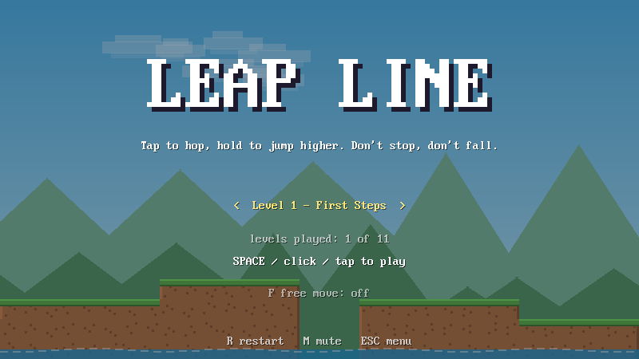
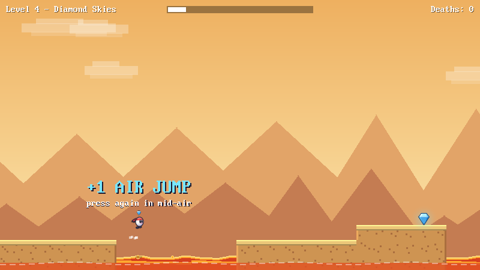
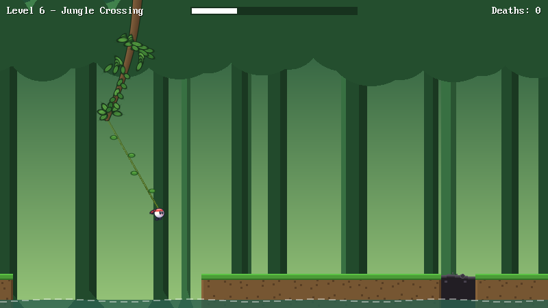
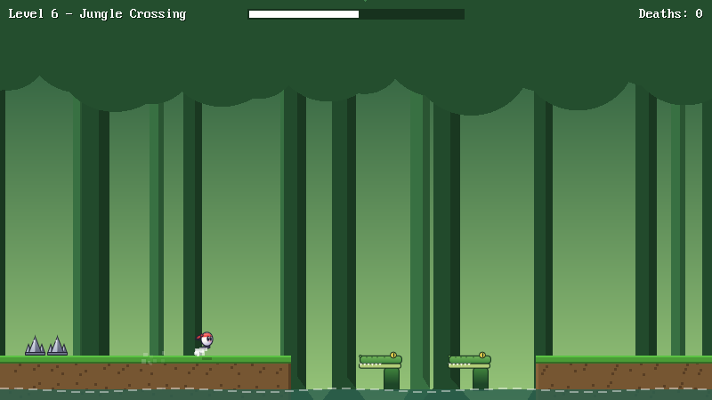
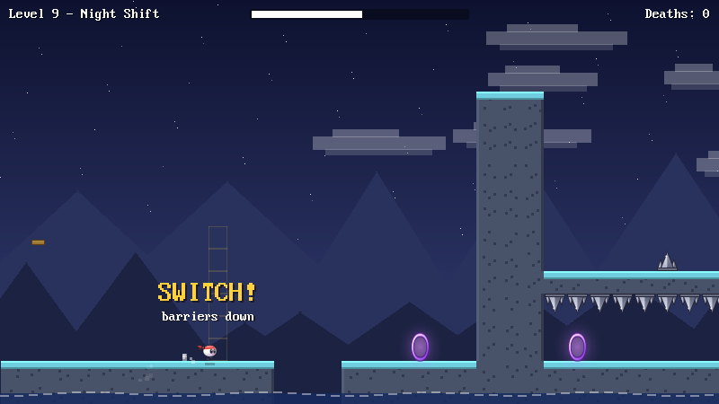
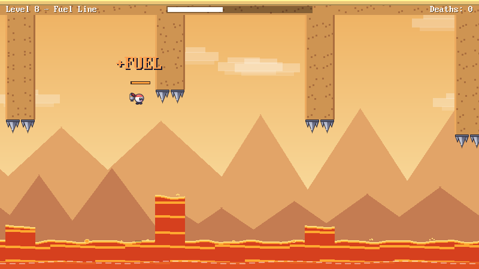
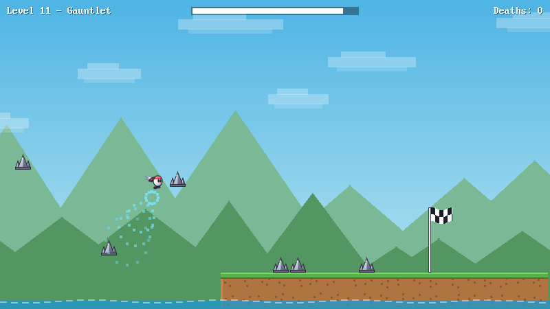
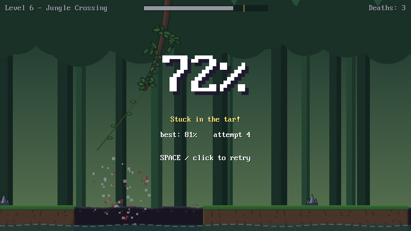

# Leap Line

*Tap to hop, hold to jump higher. Don't stop, don't fall.*

Leap Line is a small one-button platformer. The hero runs by itself and the
only thing you control is the jump: a tap gives a short hop, holding gives a
higher jump. The levels are hand-made and the same every time, so you learn
each one by dying and trying again. Retrying is instant, and the game shows
how far you got.

The same source runs in **QB64-PE** and in **QBJS**, with no QBJS-only code.

**[Play it in the browser on qbjs.org](https://qbjs.org/?src=https://raw.githubusercontent.com/FellippeHeitor/Platform/master/mrJumpS.bas)**,
or build it natively from your QB64-PE folder:

    ./qb64pe -x /path/to/mrJumpS.bas -o mrJumpS

The game is `mrJumpS.bas`.

## Controls

- **Space**, mouse button or touch: jump
- **R**: restart the attempt
- **M**: mute
- **Esc**: back to the title screen (Esc on the title quits)
- On the title screen, **Left/Right** picks any level you've already played,
  and **F** toggles free move (walk with the arrows, Space jumps, Up enters
  portals)

## 11 levels, 5 themes

The first levels add one idea at a time: steps and gaps, spikes and low
ceilings, planks you can jump up through, diamonds that give you one extra
jump in mid-air (over lava, of course), switches that drop barriers, and
teleporters.

Level 6, **Jungle Crossing**, is a nod to the jungle adventures we played on
the Atari 2600. You grab vines by touching their tips and let go with a
press, and you hop across crocodiles. A croc's head is always safe to stand
on, but its snout only while the jaws are shut. Mind the tar pits. You can
hang on a vine as long as you like: the rest of the jungle only moves on as
you gain new ground.

The last five levels are built around power-ups you can only use for a
limited time:

- **Jetpack**: hold to thrust upward. Fuel is limited (a gauge shows what's
  left), fuel cans top it up, and when it runs out you drop. Taps burn less
  fuel than holds.
- **Wings**: jump in mid-air as often as you like, for 2.5 seconds.

Every pickup (diamonds, fuel cans, jetpack, wings) can be collected once per
attempt.

When you die, you see the percentage you reached and what got you. A dotted
line then marks where your last attempt ended, so you can see whether you're
getting further.

## Under the hood

- **One source file runs in both QB64-PE and QBJS.** You can play it
  natively or in the browser.
- **Fixed 60 Hz physics** with an accumulator, so jumps behave the same at
  any frame rate. Jump height depends on how long you hold. There's a short
  grace period after you run off a ledge, and a press made just before
  landing still counts.
- **Tile-based collision**: running into a wall is fatal, but small ledges
  are climbed automatically.
- **All sounds and music are generated by the program** from sine-wave
  voices. Each theme has an eight-bar tune written as note lists (like
  `E5:2 G5:2 C6:2`), which the game turns into a looping WAV with bass,
  arpeggios and drums. There's also a short victory song.
- **Every level is checked by a solver** (see below).
- Smooth anti-aliased sprites drawn in code, parallax backgrounds,
  particles, rippling lava and tar, and squash and stretch on the hero.
- Levels are `DATA` lines with one character per tile, so making your own
  is easy.

## Progress

Levels you've played and your best percentage on each are kept in
`leapline.log` next to the game, one `name|best` line per level. Only those
levels can be picked on the title screen. Delete the file to start over. In
QBJS it lasts only as long as the page.

If you've already beaten some levels (say on another computer), run
`./mrJumpS -beaten 5` once to mark levels 1 to 5 as beaten and unlock
level 6. Anything else already in the log is kept.

## Sounds

The sound effects (`makeSoundIfMissing`) and the music (`makeMusicIfMissing`,
rendered to `sfx/music0.wav` to `music4.wav`) are generated by the game. A
native build writes any missing WAV into `sfx/` on startup and loads it from
there, so only the executable needs to be shipped. To change a sound, edit
its numbers, delete its file and run the game.

QBJS can't write files, so in the browser the game loads the committed WAVs
from this repository through jsDelivr (pinned to a commit in `sfxPath`;
update the pin and push after remaking the sounds). Files added to the QBJS
project are used first if present.

## Making levels

Levels are `DATA` lines near the top of `mrJumpS.bas`: a name, a theme
number (0 meadow, 1 dusk, 2 desert, 3 night, 4 jungle), then 18 rows of
text, one character per 25px tile. The key is in the comment above the data.

## Checking that levels can be beaten

`levelcheck.bas` (native only) includes the game with `HEADLESS` set and
runs `tools/solver.bm`, which tries every button timing through the game's
own physics code until it finds a winning run, then replays the winning
inputs to confirm them. It then reports how forgiving the level is: for the
tightest presses, how many ticks (1/60 s) early or late you can press, and
how much shorter or longer you can hold, and still make it. Under ~4 ticks
is hard; under ~2 is frame-perfect. For presses chained in the air (no
landing before the next press) that estimate is too strict, because a
player adjusts later taps and the check doesn't. It also removes each
pickup in turn and re-solves the level, listing which pickups are needed
and which can be skipped (a skippable pickup isn't doing much), and shows
how far a player who never presses gets:

    ./qb64pe -x /path/to/levelcheck.bas -o levelcheck && ./levelcheck

Run it after editing a level.

## Where it started

Leap Line grew out of a little experiment from February 2021, called
mrJumpS. The hero was a white rectangle, the level was 30 random platforms
over water, and there were no spikes, power-ups or sounds yet. It already
had the parallax mountains and the hero's shadow on the platforms.

That version is kept, playable, as `mrJumpS_2021_qbjs.bas`, changed only
where QBJS needed it to run (the header lists what changed). Space or click
to jump, Esc to restart:
**[play the 2021 version on qbjs.org](https://qbjs.org/?src=https://raw.githubusercontent.com/FellippeHeitor/Platform/master/mrJumpS_2021_qbjs.bas)**.

## platform.bas

An even earlier, free-moving platformer prototype (arrow keys, blocks,
coins and an enemy).
